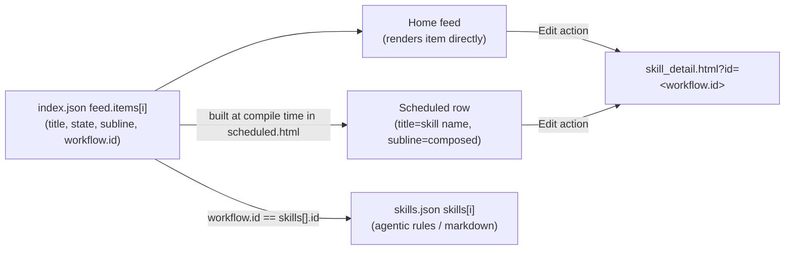

# Authoring demo workflows (agent playbook)

You are editing a static Nunjucks + JSON prototype to build a **demo**. This
file tells you exactly how to add, edit, or remove the "workflows" that appear
on the **Home feed** ("Your agent at work"), the **Scheduled** page, and the
**Skills** catalog — all three are driven by one synced data model. Follow it
literally; the rules below encode coupling that is not obvious from the files
alone.

Data files are parsed as **JSON5** (`json5` dependency), so `//` comments and
trailing commas are allowed. Keep existing comments intact.

---

## 0. The one rule

- **Edit the workflow list in exactly one place:** `src/views/data/index.json` → `feed.items[]`.
- **Edit the agentic rules in exactly one place:** `src/views/data/skills.json` → `skills[]`.
- **Never edit `src/views/data/scheduled.json` → `workflows[]`.** It is dead
  data. The Scheduled page ignores it (see the trap in §7). Changing it does
  nothing.

Everything else is derived automatically at build time.

---

## 1. Architecture — one source of truth, two derived surfaces



- **Home feed** (`index.html`, partial `src/views/_home_feed.html`) renders each
  `feed.items[]` row directly, including a `data-sh-feed-skill` hook = the item's
  `workflow.id`.
- **Scheduled** (`src/views/scheduled.html`) does **not** read `scheduled.json`'s
  workflow list. It rebuilds the rows at compile time from `index.json` →
  `feed.items` (see the `` builder near the top of the
  file). For each item it derives:
  - **title** = the backing skill's `name` (resolved via `workflow.id` →
    `skills.json`), falling back to the item's `title` if the skill is missing.
  - **subline** = the same "`<status> · <time>`" string the Home feed shows,
    composed from `state` + the time fields (see §4).
  - **skillId** = `workflow.id`, surfaced as `data-sh-workflow-skill`.
- **Edit** (the ⋮ overflow action) on **both** surfaces navigates to
  `/skill_detail.html?id=<workflow.id>` (wired in `src/scripts/home.js`).

Result: set a workflow's text/state once in `feed.items`, add one matching
skill, and Home + Scheduled + the Edit deep-link all stay in sync.

---

## 2. Files

| File | Edit for a demo? | Purpose |
|---|---|---|
| `src/views/data/index.json` → `feed.items[]` | **YES** | The workflow list (source of truth). |
| `src/views/data/skills.json` → `skills[]` | **YES** | One skill per workflow (the agentic rules). |
| `src/views/data/scheduled.json` → `workflows[]` | **NO — ignored** | Vestigial mirror. See §7. |
| `src/views/data/scheduled.json` → `tabs`, `statusTypes`, `banner`, `emptyState` | Only if needed | These *are* live on the Scheduled page. |
| `src/views/scheduled.html`, `src/views/_home_feed.html`, `src/scripts/home.js` | Only for behavior changes | The plumbing. A content-only demo should not need these. |

---

## 3. The workflow ⇄ skill contract

Each `feed.items[].workflow.id` **must equal** a `skills[].id`. If it does not:
- the Scheduled row title silently falls back to the feed's output-phrased title, and
- the Edit action opens a client-side "Skill not found" page.

Nothing errors at build time — the mismatch is silent. Always keep the ids in lockstep.

**Skill registries** a skill entry references (use only these keys):
- `agent`: one of `sales` ("Hunter"), `coworker` ("CoWorker"), `tableau` ("Tableau"). (`agentLibrary` in `skills.json`.)
- `connectedTools`: any of `sf`, `slack`, `gmail`, `gcal`, `zoominfo`. (`toolLibrary`.) Unknown keys are silently skipped.
- `status`: `published`. (`statusLibrary`.)
- `category`/`ownership` (keep both equal): `mine` (shows on the "Your Skills" tab), `shared` ("Shared with you" tab), or `learned` (tab currently hidden). For a demo workflow use `mine`.

**Current workflows (reference — keep this mapping intact unless told otherwise):**

| Home item id | state | Skill id (`workflow.id`) | Skill name (Scheduled title) |
|---|---|---|---|
| `ri-01` | completed | `sk-find-prospects` | Find Prospects |
| `ri-02` | completed | `sk-draft-proposals` | Draft Proposals |
| `ri-weekly-top-3` | completed | `sk-weekly-top-3` | Weekly Top 3 Things |
| `ri-daily-pipeline-snapshot` | completed | `sk-daily-pipeline-snapshot` | Daily Pipeline Snapshot |
| `run-01` | running | `sk-account-research` | Account Research |
| `run-02` | running | `sk-write-sales-emails` | Write Sales Emails |
| `ri-03` | scheduled | `sk-weekly-exec-brief` | Weekly Executive Brief |
| `ri-04` | scheduled | `sk-prepare-for-meetings` | Prepare for Meetings |

---

## 4. Schemas

### 4a. Feed item (`index.json` → `feed.items[]`)

```json5
{
  "id": "ri-99",                       // required, unique, stable DOM/event key
  "title": "Found new prospects",      // required; what the row reads in its CURRENT state
  "titles": {                          // optional; tense variants for runtime state swaps
    "running": "Finding new prospects",
    "neutral": "Find new prospects"    // used while paused
  },
  "cadence": "Weekly",                 // required; "Daily"/"Weekly"/etc. Left slot on scheduled rows.
  "state": "completed",                // required; see states below
  "nextRun": "Next run in 3 days",     // right slot for completed + scheduled
  "startedAt": "Started 4 min ago",    // right slot for running
  "lastRun": "Last run Thursday",      // right slot for paused + failed (always safe to include)
  "outputs": [                         // optional pills; icon ∈ table|doc|message|document|pdf
    { "icon": "table", "label": "7 accounts imported" }
  ],
  "error": "…",                        // failed rows only (replaces outputs)
  "conversationId": "conv-001",        // optional; makes the title a drill-in link (see §5c)
  "workflow": { "id": "sk-find-prospects", "label": "" }  // id = backing skill; keep label "" (empty = no pill on Home)
}
```

**States** (`feed.stateOrder`): `completed`, `failed`, `running`, `scheduled`,
`paused`, `archived`. For most demos use `completed`, `running`, `scheduled`.

**State → which time field to fill (the row's subline right slot):**
- `completed` → `nextRun`
- `scheduled` → `nextRun` (and the left slot shows `cadence`, not a status word)
- `running` → `startedAt`
- `paused` / `failed` → `lastRun`

Always include `lastRun` regardless of state (a row can be paused at runtime and
a paused row reports its last run).

`feed.statusLabels` supplies the left-slot word for non-scheduled states
("Completed", "Running now", "Paused", "Failed", "Archived"). You normally do
not touch it.

### 4b. Skill (`skills.json` → `skills[]`) — one per workflow

Copy an existing `mine` skill (e.g. `sk-write-sales-emails`) as a template and change the fields. All fields below are expected:

```json5
{
  "id":             "sk-find-prospects",   // MUST equal the feed item's workflow.id; kebab-case, sk- prefix
  "name":           "Find Prospects",      // becomes the Scheduled row title
  "agent":          "sales",               // agentLibrary key
  "status":         "published",           // statusLibrary key
  "description":    "One sentence shown on the card (2-line clamp).",
  "category":       "mine",                // keep equal to ownership
  "ownership":      "mine",
  "connectedTools": ["sf", "gmail"],       // toolLibrary keys
  "nextRun":        null,
  "sharedBy":       null,
  "canEdit":        true,
  "canShare":       true,
  "canDelete":      true,
  "actions":        ["use_in_chat", "schedule", "duplicate", "share", "delete"],
  "createdBy":      "Caroline Alix",
  "createdAt":      "Mar 6",
  "updatedBy":      "Priya Rao",
  "updatedAt":      "yesterday at 2:10 PM",
  "version":        "V1",
  "markdown":       "# Find Prospects\n\n<lead>\n\n## What this skill does\n\n…\n\n## Instructions\n\n1. …\n\n## Guardrails\n\n- …\n\n## Example output\n\n…\n",
  "linked":         true
}
```

`markdown` is the skill-detail body. Keep it plausible: a lead line, then
`## What this skill does`, `## Instructions`, `## Guardrails`, `## Example
output`. Use `\n` for newlines. To reference another skill as a chip, embed a
Markdown link `[Label](/skill_detail.html?id=<other-skill-id>)`.

---

## 5. Recipes

### 5a. Edit an existing workflow's copy or demo state
1. Open `src/views/data/index.json`, find the row in `feed.items[]` by `id`.
2. Change `title`/`titles`, `outputs`, or `state` (+ the matching time field from §4).
3. Build and verify (§6). No skill edit needed unless you also rename the workflow — then update the skill's `name` too.

### 5b. Add a NEW workflow (end-to-end)
1. **Skill:** add an entry to `skills.json` → `skills[]` using the §4b template. Pick a unique `id` (e.g. `sk-territory-review`).
2. **Feed item:** add an entry to `index.json` → `feed.items[]` using the §4a schema, setting `workflow.id` to that exact skill `id`.
3. Choose the demo `state` and fill the matching time field (§4).
4. Build and verify (§6). The row appears on Home, a matching row (titled with the skill `name`) appears on Scheduled, and Edit opens the new skill.

### 5c. (Advanced, optional) Make the row title a clickable drill-in
Only needed if the demo must open a conversation thread when the row title is clicked.
1. Add a `conversationId` to the feed item.
2. Add a matching entry to `index.json` → `conversations` (a large, structured
   registry — copy an existing conversation like `conv-001` and adapt it).
3. Without a `conversationId`, the Home row renders as a non-link and the
   Scheduled row is inert (`linked: false`). Edit still works via the skill.

### 5d. Remove a workflow
1. Delete its object from `feed.items[]`. It disappears from Home and Scheduled.
2. Optionally delete its skill from `skills.json` (only if nothing else links to it).

---

## 6. Build & verify (run these; do not skip)

```bash
npm run build          # one-shot compile to dist/  (use `npm run dev` for watch+serve)
```

Then confirm the derivation worked (adjust ids/names to your edit):

```bash
# Home feed rows carry the skill hook:
rg -o 'data-sh-feed-item="[^"]*"|data-sh-feed-skill="[^"]*"' dist/index.html

# Scheduled rows: id / skill / title / subline all present and matching:
rg -o 'data-sh-workflow-id="[^"]*"|data-sh-workflow-skill="[^"]*"|scheduled-workflow-title">[^<]*|scheduled-workflow-meta">[^<]*' dist/scheduled.html

# New/renamed skill resolves in the detail catalog and on the Skills page:
rg -o '"id":"sk-YOURID"' dist/skill_detail.html
rg -o '>Your Skill Name<' dist/skills.html
```

A successful build prints `Finished 'build'` with no errors. If `npm run build`
fails, it is almost always malformed JSON5 — check the file you just edited.

---

## 7. Gotchas (read before you touch anything)

1. **`scheduled.json` → `workflows[]` is a decoy.** `scheduled.html` overrides it
   with `` and rebuilds from `feed.items`. Editing it has
   zero effect. Do all workflow edits in `index.json`. (It is kept only as an
   accurate mirror for reference.)
2. **Silent id mismatch.** A `workflow.id` with no matching skill does not error —
   the Scheduled title falls back and Edit hits a "Skill not found" page. Verify
   ids match (§6).
3. **State ↔ time-field pairing.** If you set `state: "running"` but only fill
   `nextRun`, the subline right slot is blank. Fill the field the state uses (§4).
4. **Runtime demo state persists in `localStorage`.** Pausing/running/archiving a
   row is remembered across reloads. If the UI looks stuck from a previous demo,
   load any page with **`?reset=1`** appended to the URL to clear it.
5. **`agent_at_work.html` is a separate lab surface** with its own
   `agent_at_work.json`. It is not part of this synced model; do not edit it for
   a Home/Scheduled/Skills demo.
6. **Do not edit the plan file or CSS/markup for content changes.** A demo is a
   pure JSON exercise: `index.json` (+ `skills.json`). Keep it that way.

---

## 8. Definition of done (self-check before reporting success)

- [ ] Every `feed.items[].workflow.id` equals an existing `skills[].id`.
- [ ] Any new skill has a unique `sk-` id, valid `agent`/`connectedTools`/`category` keys, and a full `markdown` body.
- [ ] Each edited item's `state` has its matching time field filled (§4).
- [ ] `npm run build` completed with no errors.
- [ ] The §6 `rg` checks show the workflow on Home, on Scheduled (titled with the skill name, correct subline), and in the skill catalog.
- [ ] You did **not** edit `scheduled.json` → `workflows[]`.
